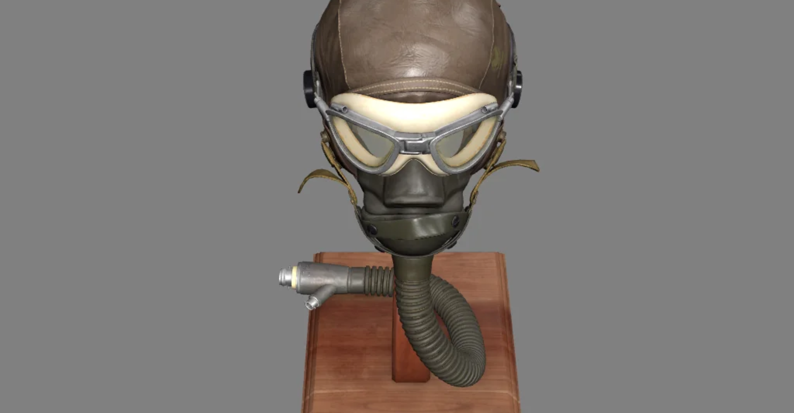
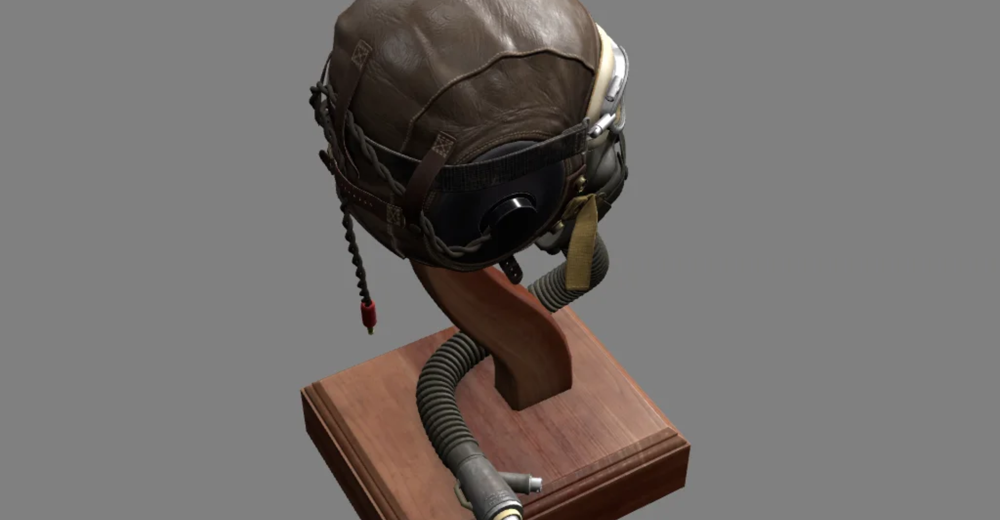
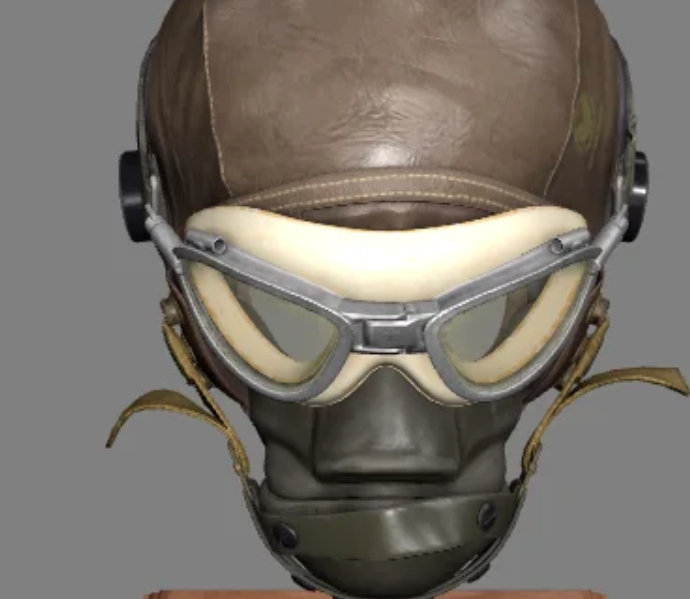
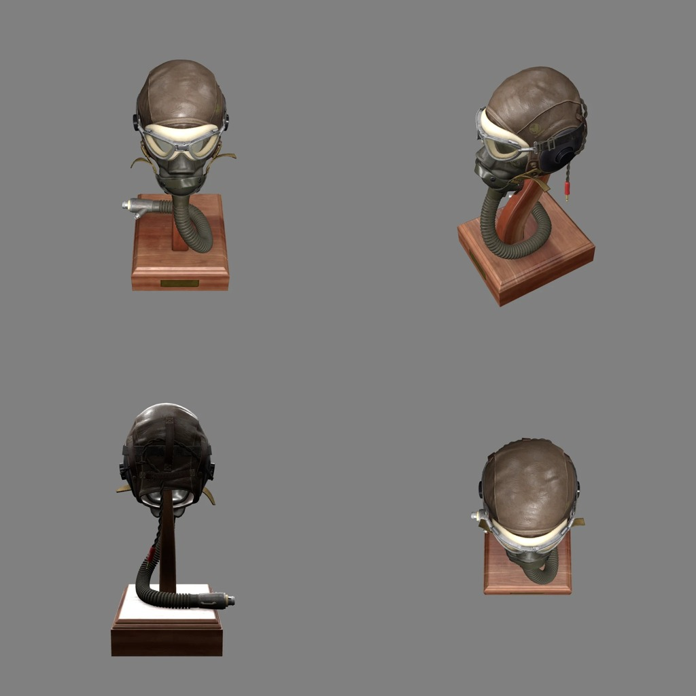

# splat-turntable

[](https://splat-turntable.netlify.app/)
[](LICENSE)

**レンダリング画像から、360°回せる商品ビューアー（静的HTML）を作るパイプラインです。**

ドラッグしている間は軽くて滑らかな **3D Gaussian Splatting（3DGS）** で回し、指を離すと一番近いカメラ位置まで寄って **高解像度な2D画像（ディープズーム）** に切り替わります。「回す」と「じっくり見る」を分担させるハイブリッド構成が特徴です。



> **まずは触ってみてください → [Live Demo（Netlify）](https://splat-turntable.netlify.app/)**
> ドラッグで回転、ホイール／ピンチでズーム。離すと最寄りのカメラ位置にスナップして高解像度画像に切り替わります。
> ※デモは 1024×1024px・18カメラ（3リング×6方向）のサンプルです。本番では8K画像を想定しています。初回はモデルの読み込みに少し時間がかかり、その間は無地の画面になります。

---

## 目次

- [スクリーンショット](#スクリーンショット)
- [何ができるか](#何ができるか)
- [仕組み](#仕組み)
- [クイックスタート](#クイックスタート)
- [使い方（詳細）](#使い方詳細)
- [2回目以降（モデルを更新したとき）](#2回目以降モデルを更新したとき)
- [設定：生成側（pipeline.ini）](#設定生成側pipelineini)
- [ビューアーの操作](#ビューアーの操作)
- [設定：ビューアー側（site/config.json）](#設定ビューアー側siteconfigjson)
- [フォルダ構成](#フォルダ構成)
- [付属ツール（任意）](#付属ツール任意)
- [トラブルシュート](#トラブルシュート)
- [動作環境](#動作環境)
- [使っているもの](#使っているもの)
- [ライセンス](#ライセンス)

## スクリーンショット

| 状態 | 画面 |
|---|---|
| **回転後（別の角度）** ― ドラッグを離すと最寄りのカメラ位置へスナップし、シャープな2D画像で表示されます。レザーの継ぎ目やステッチ、編み込みコードまで確認できます。 |  |
| **ズーム（寄り）** ― ズームはカメラ位置ではなく画角（FOV）だけを変えます。停止時はディープズーム（DZI）が担当するので、寄ってもピクセルが粗くなりません。 |  |
| **いろいろな角度** ― デモの元になったレンダリング画像の一部です。正面／斜め／背面／真上といった複数のカメラを用意するほど、スナップ先が増えて滑らかになります。 |  |

## 何ができるか

- **回転中は3DGS、停止中は高解像度2D** ― 3DGSの粗が目立つ「寄り」は2D画像に任せ、3DGSは「移動中の補間」だけに使います
- **少ない枚数で滑らか** ― 画像を何百枚も送る従来のターンテーブルと違い、カメラ枚数を増やさなくてもドラッグに追従します
- **初回読み込みが軽い** ― 3DGSは圧縮形式（SOG）で配布し、2D画像は必要なタイルだけを読み込むディープズーム方式です
- **静的サイトとしてそのまま公開** ― 出力は `site/` フォルダ一式だけ。サーバーに置けば動きます（Netlify等の静的ホスティングでOK）
- **差分だけ作り直し** ― 2回目以降は、変更のあった画像だけ再タイル化し、必要なら3DGSも自動で再学習します

### こんな人向け

- 3DCGでレンダリングした商品・作品を、Webでぐるっと回して見せたい人
- 高解像度な質感（革、金属、木目など）を、拡大しても劣化なく見せたい人

## 仕組み

```text
レンダリング画像 + カメラ情報（COLMAP形式）
        │
        │  bash run.sh /path/to/フォルダ
        ├─→ 3DGS学習（Brush）→ 圧縮（SOG）        … 回転中の表示用
        ├─→ 高解像度画像をタイル化（DZI / libvips） … 停止・ズーム時の表示用
        ▼
   site/  ← この中身をサーバーに置くだけ
           （index.html / model.sog / dzi/ / sparse/ / config.json）
```

ビューアー側の動きはシンプルです。

1. **ドラッグ中**：3DGSを表示し続ける（どの角度でも破綻なく回せる）
2. **離したとき**：一番近い撮影カメラの方位・仰角へ約450msでスナップ
3. **停止後**：そのカメラの高解像度画像へフェードで切り替え、ズームはディープズームで表示

## クイックスタート

前提はLinuxです。詳しい注意点は次の「使い方（詳細）」にあります。

```bash
# 1) 必要なツールを入れる（詳細は下記）
sudo apt install libvips-tools        # タイル化
# Brush（3DGS学習）は Releases からLinux版を取得してPATHへ
# https://github.com/ArthurBrussee/brush/releases

# 2) 素材フォルダを用意する
#    マイフォルダ/
#      images/    r00_a00.png, r00_a01.png, ...（レンダリング画像、8K推奨）
#      sparse/0/  cameras.txt, images.txt      （カメラ情報、COLMAP形式）

# 3) 実行する（完了後に確認用サーバーまで自動起動する場合は --serve）
bash run.sh /path/to/マイフォルダ --serve
# → ブラウザで http://localhost:8000/ を開く
```

出力された `site/` の中身を静的サーバーに置けば公開完了です（`file://` で直接開いても動きません）。

## 使い方（詳細）

### 1. ツールを入れる（Linux）

| ツール | 用途 | 入れ方 |
|---|---|---|
| [Brush](https://github.com/ArthurBrussee/brush) | 3DGS学習（Vulkanで動作。CUDA不要） | [Releases](https://github.com/ArthurBrussee/brush/releases) からLinux版を取得してPATHへ |
| libvips | タイル化 | `sudo apt install libvips-tools` |
| Node.js 22以上 + [splat-transform](https://github.com/playcanvas/splat-transform) | 3DGSの圧縮（任意） | `nvm install 22 && npm i -g @playcanvas/splat-transform` |

圧縮ツールが無くても動きます（その場合は非圧縮の `model.ply` で出力され、サイズが大きくなります）。

### 2. 素材を用意する

フォルダを1つ作り（**場所も名前も自由**）、中に次を入れます。

```text
(好きな名前のフォルダ)/
  images/     r00_a00.png, r00_a01.png ...   レンダリング画像。ファイル名がカメラ名。8K推奨
  sparse/0/   cameras.txt, images.txt        カメラ情報（COLMAP形式）
```

画像とカメラ情報は、お使いのレンダラーから書き出してください。形式の詳細は [docs/SPEC.md](docs/SPEC.md) にあります。

- 全画像で**同一サイズ・同一FOV**にしてください
- 被写体の中心（注視点）を向くオービット配置が前提です

### 3. 実行する

**コマンドで実行**

```bash
bash run.sh /path/to/フォルダ
```

パスに空白が含まれるときは `"..."` で囲みます。`bash` を付ければ、実行権限の設定は要りません。

**ダブルクリックで実行**

`run.sh` と同じ場所に `images/` と `sparse/` を置き、ファイルマネージャーで `run.sh` を実行します（「端末で実行」などを選びます。お使いの環境で変わります）。終わるとEnter待ちになるので、結果を確認してから閉じてください。

### 4. 確認する

実行が終わると、確認用のコマンドが表示されます。

```bash
python3 -m http.server 8000 --directory "…/site"
```

これを実行して、ブラウザで http://localhost:8000/ を開きます。止めるときは Ctrl+C です。
実行時に `--serve` を付けると、完了後に自動で起動します（`bash run.sh /path/to/フォルダ --serve`）。

### 5. 公開する

出力された `site/` の中身を、そのまま静的なWebサーバーに置きます（`file://` で直接開いても動きません）。

## 2回目以降（モデルを更新したとき）

画像（と `sparse/`）を差し替えて、もう一度 `run.sh` を実行するだけです。HTMLは触りません。

- 変更のあった画像だけが再タイル化されます
- 画像・カメラ・設定が前回から変わっていれば、3DGSは自動で再学習されます
- **既存の成果物が最新のとき**は、最初に「作り直しますか?」と聞きます（処理の途中では聞きません）

```bash
bash run.sh /path/to/フォルダ -y       # 確認せず、すべて作り直す
bash run.sh /path/to/フォルダ --keep   # 確認せず、最新のものはそのまま使う
bash run.sh -h                         # ヘルプ
```

## 設定：生成側（pipeline.ini）

リポジトリ直下の `pipeline.ini` が既定値です。**素材のフォルダに `pipeline.ini` を置くと、そちらが優先**されます（必要な項目だけ書けば十分）。`-c 設定ファイル` で別のファイルも指定できます。

これは「生成」の設定（学習・タイル・圧縮・出力）です。ビューアーの見え方は、下の `config.json` で変更します。

| 項目 | 既定 | 説明 |
|---|---|---|
| `[train] steps` | 2000（同梱 `pipeline.ini` の値。iniが無い場合の `run.sh` 内フォールバックは10000） | 学習ステップ数。**時間と品質に最も効く**。時間はほぼ比例 |
| `[train] max_resolution` | 1920 | 学習時に画像を縮小する長辺px。2D画像は8Kのまま使われる |
| `[tiles] format` | webp | `webp`（軽い） / `jpg`（互換性重視） |
| `[tiles] quality` | 85 | タイルの画質（1-100） |
| `[compress] sh_bands` | 0 | 3DGSの視点依存の色。0が最小・最速 |
| `[output] dir` | site | 出力フォルダ名 |
| `[output] keep_ply` | 同梱 `pipeline.ini` では `yes` | 学習結果の非圧縮PLY（SOG変換用の中間ファイル。サイトには入らない）を、変換後に残すか。`yes` なら圧縮設定だけの変更は再学習なしで済む |
| `[advanced] tile_size` / `jobs` / `parallel` / `brush_args` | 510 / 0 / yes / （空） | 通常は触らない |

## ビューアーの操作

| 操作 | 動作 |
|---|---|
| ドラッグ | 回転（3DGSで表示） |
| 指／マウスを離す | 最寄りのカメラ位置へ移動し、高解像度画像（2D）に切り替わる |
| ホイール／ピンチ | ズーム（画角＝FOVのみ変更。カメラ位置は動かない） |

画面のアスペクト比が違っても、短辺合わせで長辺側が見切れるだけです。

`index.html?debug` を付けると、手元のGLB・PLYやフォルダを選んで確認できるデバッグ用の画面が出ます（通常は表示されません）。

## 設定：ビューアー側（site/config.json）

出力された `site/config.json` を、テキストエディタで直接編集します。**`run.sh` を再実行しても上書きされません**（無いときだけ雛形が作られます）。
再生成しなくても、保存してブラウザを再読み込みすれば反映されます。

| キー | 既定 | 説明 |
|---|---|---|
| `initial.az` / `initial.el` | 0 / 30 | 初期の方位角・仰角（度） |
| `zoom.initial` / `zoom.min` / `zoom.max` | 1 / 1 / 8 | ズーム倍率（画角を狭める倍率） |
| `splatUpsideDown` | false | 3Dが上下逆に表示されたら `true` |
| `snapMs` | 450 | 最寄りのカメラへ移動する時間（ミリ秒） |
| `fadeMs` | 300 | 2D画像へ切り替わるフェードの時間（ミリ秒） |
| `dragSpeed` | 0.35 | ドラッグの感度（度/px） |

書式を間違えると画面に「config.json の書式が正しくありません」と表示されます。

## フォルダ構成

このリポジトリ：

```text
run.sh              入口。画像フォルダ → サイトまで一括
pipeline.ini        設定（コメント付き）
scripts/            make_dzi.sh（タイル化）、compress_splat.sh（圧縮）。単体でも使える
viewer/index.html   ビューアー（サイトにコピーされる。固定）
viewer/config.json  ビューアー設定の雛形（site/ に無いときだけコピーされる）
tools/              付属の書き出しツール（任意）
docs/SPEC.md        入出力の仕様
docs/images/        このREADME用のスクリーンショット
```

生成されるサイト（`site/`）：

```text
site/
  index.html          ビューアー（固定。編集しない）
  model.sog           3DGS（圧縮ツールが無い場合は model.ply）
  sparse/0/           cameras.txt, images.txt
  dzi/                <カメラ名>.dzi + <カメラ名>_files/（ディープズーム用タイル）
  config.json         ビューアーの設定
```

仕様の詳細は [docs/SPEC.md](docs/SPEC.md) を参照してください。

## 付属ツール（任意）

`tools/orbit-exporter.html` は、GLBから上記の形式（画像・カメラ）を書き出す簡易ツールです。Chromeで開きます。
他のレンダラーを使う場合は不要です。

## トラブルシュート

| 症状 | 対処 |
|---|---|
| ブラウザで何も出ない | `file://` では動きません。確認用サーバー（上の手順4）を使う。初回はモデル読み込みに時間がかかる場合があります |
| `Format not recognized`（Brush） | `sparse/0/` の場所を確認。Brushが古い場合は最新版に更新 |
| タイル化でメモリ不足 | `pipeline.ini` の `[advanced] jobs` を減らす（例: 2） |
| 3Dが上下逆 | `site/config.json` の `splatUpsideDown` を `true` に |
| 3Dと2Dの切り替え時に位置がずれる | 全画像のFOV・サイズが同一か、カメラ情報が画像と対応しているか確認 |
| 学習をやり直したい | `-y` を付ける、または `.build/` を削除 |
| `sh_bands` を変えたら再学習になった | `keep_ply = no` のため。`yes` にすると、圧縮設定だけの変更は再学習なしで済む |

## 動作環境

- Linux（Linux Mint 22 で開発）。bash前提のため、Windows / macOS は未確認です
- GPU: Brush が動くVulkan対応GPU
- 開発中のプロジェクトです。仕様は変わる可能性があります

## 使っているもの

[Brush](https://github.com/ArthurBrussee/brush)（Apache-2.0）、[libvips](https://github.com/libvips/libvips)（LGPL、外部コマンドとして使用）、
[splat-transform](https://github.com/playcanvas/splat-transform)（MIT）、[Spark](https://github.com/sparkjsdev/spark)（MIT）、
[OpenSeadragon](https://openseadragon.github.io/)（BSD-3-Clause）、[three.js](https://threejs.org/)（MIT）

## ライセンス

MIT License ― [LICENSE](LICENSE) を参照してください。
